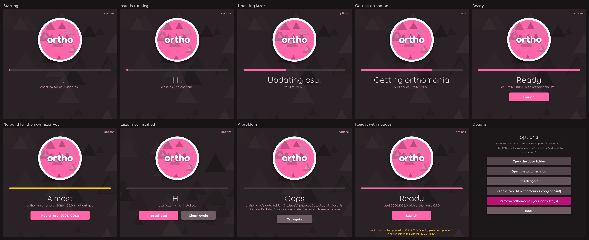

# orthomania

osu!mania where notes approach angled instead of straight down, as a patch for official osu!(lazer) rather than a copy of the game.

Starting osu! starts plain lazer. Starting `orthomania.exe` checks for updates, then starts lazer with orthomania hooked in. Neither touches the other's files or data.



## How it works

On every launch the patcher:

1. finds official lazer (`%LOCALAPPDATA%\osulazer`) and checks that orthomania's folders and data are apart from it;
2. waits until no lazer is running ("close osu! to continue");
3. updates lazer if a newer release is out, with lazer's own updater (Velopack, the same feed and `Update.exe` lazer uses);
4. gets the orthomania build made for exactly the installed lazer release, checking every file against its hash;
5. prepares the folder lazer runs from for orthomania, and waits on **Ready**;
6. on **Launch**, backs up the database before a new lazer release first opens it, starts lazer from that folder, and moves screenshots to osu!(stable) once it closes.

If there is no build for a new lazer release yet, plain lazer is updated anyway and the patcher offers the last release orthomania worked on.

| Folder | What is in it | Changed by |
| --- | --- | --- |
| `%LOCALAPPDATA%\osulazer` | Official lazer | Only lazer's own updater |
| `%APPDATA%\osu` | Plain lazer's data | Only plain lazer |
| `%LOCALAPPDATA%\orthomania\lazer\<release>` | Hard links to that release's files, plus the ruleset DLL, `0Harmony.dll`, `framework.ini` and `storage.ini` | The patcher |
| `%LOCALAPPDATA%\orthomania\builds`, `backups`, `logs` | Downloaded builds, database backups, the patcher's log | The patcher |
| `Documents\Projects\osu!\ortho-data` (or `%APPDATA%\orthomania\data`) | orthomania's game data | lazer, when the patcher starts it |
| `%LOCALAPPDATA%\orthomania\server` | The score server's data, when the patcher starts it (development only) | The score server |

Lazer loads `osu.Game.Rulesets.*.dll` from the folder it runs from, and the DLL puts its hooks in as it loads. `framework.ini` beside the game keeps lazer's storage there, and `storage.ini` points it at orthomania's data. A hard link is a second name for the same file, so the folder costs no space and is byte for byte the official release; it also keeps an older release whole after lazer updates, to fall back on.

## Releases

Each build is a GitHub release tagged `lazer-<lazer release>-<build>` (for example `lazer-2026.1026.0-0.1.0`) with `orthomania.json` and the files it lists:

```json
{
  "format": 1,
  "lazer": "2026.1026.0",
  "build": "0.1.0",
  "files": [
    { "name": "osu.Game.Rulesets.ManiaOrtho.dll", "sha256": "…", "size": 123456 },
    { "name": "0Harmony.dll", "sha256": "…", "size": 123456 }
  ]
}
```

A build is only ever put beside the lazer release it names, and it can add files to lazer's but never replace one. The patcher itself is released as `patcher-<version>`.

## Building

Needs the .NET 10 SDK. The patcher and the score server are built and tested apart, each from its own folder:

| Folder | What it is |
| --- | --- |
| `patcher/` | The patcher: `Orthomania.Patcher.sln`. The ruleset joins it here. |
| `server/` | The score server: `OrthoServer.sln`, with its own tests, API contract and scripts ([server/README.md](server/README.md)) |

The files at the top (`global.json`, `Directory.Build.props`, `.editorconfig`, CI) are shared by both.

```
dotnet test patcher/Orthomania.Patcher.sln
dotnet publish patcher/src/Orthomania.Patcher -c Release -r win-x64 --self-contained -o artifacts/patcher
```

| Project | What it is |
| --- | --- |
| `patcher/src/Orthomania.Patcher.Core` | Everything the patcher does, without its window |
| `patcher/src/Orthomania.Patcher` | The window (`orthomania.exe`), drawn with osu-framework in lazer's style |
| `patcher/tests/Orthomania.Patcher.Tests` | Tests on stand-in installs, feeds, builds and servers, including Velopack's real update code |

The window uses lazer's Torus font, read at run time from the installed lazer's `osu.Game.Resources.dll`; lazer's resources are licensed separately, so they are never shipped here. Without lazer it falls back to Roboto.

To see a state without checking or changing anything: `orthomania --demo ready` (also `starting`, `waiting`, `updating`, `getting`, `fallback`, `notinstalled`, `problem`, `notice`, `options`). Add `--screenshot file.png` to save it and close, and `--lazer-resources path\to\osu.Game.Resources.dll` to use Torus from elsewhere.

### Starting the score server with the game (development only)

For testing, the patcher can start the score server when you press **Launch** and stop it when osu! closes. Turn it on in **Options** ("Start the score server with osu! (dev)"), or in `%LOCALAPPDATA%\orthomania\settings.json`:

```json
"devServer": {
  "enabled": true,
  "executable": null,
  "arguments": null,
  "dataFolder": null,
  "healthUrl": "http://127.0.0.1:7727/api/health",
  "startTimeoutSeconds": 30
}
```

With everything left at `null` it runs `server\OrthoServer.exe` (or `OrthoServer.dll`, with `dotnet`) beside the patcher as `OrthoServer serve --port 7727 --data %LOCALAPPDATA%\orthomania\server --parent-pid <patcher>`. In `arguments`, `{port}`, `{data}` and `{pid}` are filled in. If a server already answers at `healthUrl`, it is used and left running. The server's output goes to `logs\server.log`. The patcher only starts or waits for a server on this computer (`127.0.0.1`, `localhost` or `::1`). If the server does not start, osu! starts anyway with a notice, and the game sends its plays once a server answers.

This option goes away once the server runs on its own for public playtesting.

## Status

The patcher comes first. The score server is in `server/`; the ruleset and its hooks move into `patcher/` once their own work lands. Until then there are no builds to download.

osu!, osu!(lazer) and their logos are ppy's; orthomania is not affiliated with ppy.
